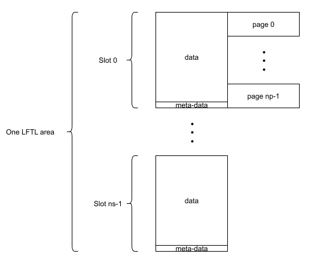

.. _design:

Anti-tearing and wear leveling
==============================

*lean-ftl* keeps, per area, one block of data that the application updates atomically: after a
power cut at any instant, the block reads as the last committed version or as the one before it,
never a mix of the two and never nothing. It also spreads the erases over the area, so that the
data can be updated many more times than one page endures. This page describes how both are done
for the two kinds of areas: the layout on the flash, how an update is written, how the first
access after a reset locates the current data (the *scan*), what a power cut can leave behind and
what the scan does about it, and what each update costs in wear. What the library relies on from
the flash is on the :ref:`flash` page, whose statements R1 to R8, N1 to N5 and T1 to T5 are cited
below; what an attacker can do with all this is in the
`threat model <https://github.com/sebastien-riou/lean-ftl/blob/main/THREAT-MODEL.md>`_ of the
repository, whose objectives O1 to O5 and threats T1.5 to T1.13 are cited too.

.. _design-common:

Common ground
-------------

**Versions and checksums.** Every copy of the data on the flash carries a 32-bit *version* and a
32-bit *checksum*, the CRC32C of the data plus the version. :c:func:`lftl_format` writes
version 1; every update writes the current version plus one. A copy is *valid* when its checksum
matches its data and version, and the valid copy with the highest version is the current one. The
version is not expected to wrap: 4.3 billion updates exceed the endurance of any area.

**Meta-data items.** The version, the checksum and a third item, the *end marker*, each occupy one
write unit, 4 bytes at least (R2 of the flash page): the value is in the first 4 bytes and the
bytes next to it are programmed to zero with it. A whole item therefore reads one of three ways:
all erased, when it was never programmed; a value, with some bits still erased when a power cut
interrupted its program; or all zeros.

**Write order.** An update programs the data first, then the version and the checksum, then the
end marker, last and in its own write unit. In a regular area the end marker is ``checksum2``, a
second copy of the checksum; in an EWLF area it is an all-zero unit. Either way a copy whose end
marker is complete is complete.

**What a power cut leaves.** Of all the words an update programs, only the one being programmed at
the instant of the cut can be left *weak*: the ones before it are complete, the ones after it
erased (T1 and T2 of the flash page). A weak word may read any value, differently from one read
to the next, and may later read all erased. A cut during the data, or during the version and the
checksum, leaves a copy whose checksum does not verify: the scan skips it and never trusts a word
of it. A cut during the end marker leaves a copy whose checksum is complete, since the end marker
is programmed after it. The one case that needs care is a cut during the checksum word itself: the
checksum may be weak, read as valid at one boot and not at the next, and the only sign of it is an
end marker that reads all erased.

**The scan reads and chooses; it never erases.** The first access to an area after a reset locates
its current copy. The scan reads the flash and chooses; the only thing it ever programs is a word
of zeros, on a flash that allows it, and it never erases, so that a power cut at every boot never
costs an erase: wear stays what the application's own updates cost (T1.5 of the threat model).
The copy with the highest valid version is taken, and its end marker, read once, decides the rest:

- complete, or all zeros: the copy is current. This is every boot in normal operation;
- programmed in part: the update got to its last word, so the checksum before it is complete and
  the copy is stable. It is current. On a flash with ``zero_overwrite`` the end marker is *pinned*
  first, so that it cannot read all erased at a later boot and bring the previous version back;
- all erased: the cut came during the checksum word at the latest, which may be weak. The copy is
  not taken: the previous version is current, and it is stable, since it was current when the
  interrupted update began. On a flash with ``zero_overwrite`` the copy not taken is *tombstoned*
  first: its version item is pinned to zeros, so that its checksum can never verify again and the
  copy cannot come back at a later boot as a "new" version once its end marker reads differently.

**Pinning.** To pin a write unit is to program it to all zeros, whatever it holds. Every cell gets
a full programming pulse, so a pinned unit reads zeros for good, and on flash with ECC it should
leave a valid codeword in place of the inconsistent one a torn program left (T1.13 of the threat
model says what remains to be measured there). Pinning needs a flash that accepts an all-zero
program over a partially programmed unit, N3 of the flash page: an opt-in capability, declared
per NVM with the ``zero_overwrite`` member of :c:type:`lftl_nvm_props_t`. The library never pins a
unit that already reads all zeros. A pin or a tombstone is one word program, made once, since the
pinned word then reads zeros for good; a power cut during it leaves a word closer to settled,
decided again at the next boot. Without ``zero_overwrite`` the scan programs nothing at all and
makes the same choices again at every boot, on the word as it reads then, until the next update
settles them: :ref:`design-without-pinning` says what that changes.

**Bounded time.** Every loop in the library runs over a quantity fixed by the configuration: the
number of slots, of pages, of records in a page. Each operation therefore has a worst case that
follows from the configuration alone (O5 of the threat model). Within that bound the scan's time
depends on what the flash holds; an update's does not, except where noted below.

.. _design-std:

Regular areas
-------------

Layout
^^^^^^

A regular area, declared with :c:macro:`LFTL_AREA`, is ``ns`` slots of ``np`` pages each: ``np``
is the smallest number of pages that holds the data plus the three meta-data items, and ``ns``,
the wear leveling factor, is at least 2. The data sits at the start of a slot and the meta-data at
its very end; the rest of the slot, between the two, stays erased::

  one slot, np pages
  +---------------------------+------------------- - - -+------+------+------+
  | data                      | erased                  | ver  | chk  | chk2 |
  | data_size bytes,          |                         |      |      |      |
  | whole write units         |                         |      |      |      |
  +---------------------------+------------------- - - -+------+------+------+
  ^ slot base                                            meta-data items

The data of a regular area is whole write units, which registration checks, so that a transaction
can commit it unit by unit.

Format
^^^^^^

:c:func:`lftl_format` erases the whole area and writes the meta-data of version 1 in slot 0, over
the erased data. It is not protected against a power cut: a cut during it leaves an area with no
valid version, which the application must detect with a flag of its own, kept in another area, and
format again (T1.6 of the threat model).

Update
^^^^^^

An update outside a transaction, :c:func:`lftl_write`, :c:func:`lftl_basic_write` or
:c:func:`lftl_erase_all`, goes to the *next slot*, the one after the current slot, wrapping from
the last slot to slot 0:

1. the next slot is erased, whatever it holds;
2. the new data is programmed into it: the bytes before and after the written range are copied
   from the current slot, the range itself comes from the caller's buffer, and a write unit that
   the range only partly covers is assembled in RAM from both. Every write unit is programmed once
   (R3). :c:func:`lftl_erase_all` programs nothing inside its range, which then reads as erased;
3. the version, the current one plus one, and the checksum are programmed in one call, then
   ``checksum2`` in its own write unit, last;
4. the context now points at the new slot.

An update costs one slot erase plus one slot's worth of programming, whatever the flash holds and
whatever a power cut left: it erases its target unconditionally, and the scan never leaves anything
in its way. That is the fixed cost O5 of the threat model promises, and the reason a counter
updated at every boot does not belong in a regular area.

Transactions
^^^^^^^^^^^^

A transaction updates several ranges of the data atomically, without a RAM copy of the whole data.
It uses a caller-owned bitmap, the *transaction tracker*, one bit per write unit of the data
(:c:macro:`LFTL_TRANSACTION_TRACKER_SIZE`):

- :c:func:`lftl_transaction_start` erases the next slot and clears the tracker;
- :c:func:`lftl_transaction_write` programs its range straight into the next slot, whole write
  units, and marks them in the tracker; a second write to a unit already marked is refused with
  :c:macro:`LFTL_ERROR_TRANSACTION_OVERWRITE`, since a unit is programmed once between two erases.
  :c:func:`lftl_transaction_write_any` accepts unaligned ranges and assembles the partial units
  from the current data;
- :c:func:`lftl_transaction_commit` copies every unit the tracker does not mark from the current
  slot, then programs the meta-data as an update does. The new slot is current from its end marker
  on;
- :c:func:`lftl_transaction_abort` forgets the tracker. The next slot stays as it is, erased or
  partly programmed, and the next update erases it again.

Until the commit, :c:func:`lftl_read` returns the current, committed data; :c:func:`lftl_read_newer`
and :c:func:`lftl_transaction_read` return the new value of the units written so far and the
current one elsewhere. An error raised inside a transaction aborts it before the error handler
runs. Each start costs a slot erase, committed or not.

.. _design-std-scan:

Scan
^^^^

The first access after a reset runs the scan of the area, once:

1. every slot's version is read. A slot whose version reads all ones, never programmed, is
   skipped, and so is a slot whose checksum does not match its data and version, whatever its
   version word reads: a slot whose erase was interrupted can read as any version, the current one
   included. The highest valid version wins. Two valid slots with the same version is
   :c:macro:`LFTL_ERROR_VERSION_COLLISION`; no valid slot at all is
   :c:macro:`LFTL_ERROR_NO_VALID_VERSION`, the state of an area never formatted, or whose format
   was interrupted;
2. the winner's ``checksum2`` unit is read, once, and decides as in :ref:`design-common`:

   - equal to the checksum, or all zeros: the slot is current;
   - programmed in part: the slot is current; with ``zero_overwrite`` its ``checksum2`` unit is
     pinned first. A unit that reads all zeros is one that was pinned, or a checksum that happens
     to be 0 written in full, and is never pinned again; the tombstone below uses the version
     item, which is never 0 since format writes 1, so no checksum value can be mistaken for one;
   - all erased, and another slot is valid: the previous version is current. With
     ``zero_overwrite`` the torn slot is tombstoned, its version item pinned to zeros; without it
     the slot is left as it is. The scan then runs again, leaving that slot out;
   - all erased, and no other slot is valid: the slot is taken as it is. Nothing in normal
     operation produces that state, and taking it beats having nothing.

The scan never erases, and sets the context from the index of the slot it chose, never from a
value read on the flash. The torn slot, when there is one, is the slot after the current one: it
is the target of the next update, which erases it.

Wear leveling
^^^^^^^^^^^^^

Updates use the slots in turn, so each page of the area is erased once per ``ns`` updates: the
area endures ``ns`` times what one page endures, and ``ns`` is the wear leveling factor given to
:c:macro:`LFTL_AREA`. The price is ``ns`` times the pages the data needs, one slot per unit of the
factor, even when the data is a few bytes. That is what EWLF areas are for.

.. _design-ewlf:

EWLF areas
----------

An EWLF area, for Extreme Wear Leveling Factor, declared with :c:macro:`LFTL_AREA_EWLF` and
registered with :c:func:`lftl_register_area_ewlf`, packs many copies of the data, the *records*,
into each erase unit: the data and its meta-data travel together, and an erase is paid once per
unit's worth of updates instead of once per update. It is meant for data small compared to the
page, and it gives up transactions: every update writes a whole record. The area is at least 2
erase units, at least 2 records must fit in a unit, and the erased bytes of the flash must read
``0xFF`` (R6 of the flash page): free record positions are recognized by that value.

Layout
^^^^^^

A record is a header followed by the data::

  one record
  +-------+--------+-----+-----+--------+---------------------------+-----+
  | magic | start  | ver | chk | end    | data                      | pad |
  |       | marker |     |     | marker | data_size bytes           |     |
  +-------+--------+-----+-----+--------+---------------------------+-----+

- the *magic*, a 64-bit constant, in one write unit of at least 8 bytes;
- the *start marker*, one write unit, programmed to all zeros, and the first word of the record to
  be programmed;
- the three meta-data items of :ref:`design-common`: the version, the checksum and the *end
  marker*, one write unit each, the end marker programmed to all zeros, and last;
- the data, rounded up to whole write units;
- a pad that rounds the record up to a multiple of 8 bytes, so that every record's magic is
  aligned.

Records only ever start at *positions*: the top of an erase unit, which is the unit's end minus
one record size, and every record size below it. Only positions are ever examined, so the data can
never be mistaken for a record, even when it holds a copy of a header, and every record lies
within one erase unit. Positions fill a unit from its top down, and the units are used from the
highest address down, wrapping from the lowest back to the highest. Three units, four records per
unit, the data at its 11th update of the current cycle; ``U2`` is the unit at the highest address,
``p0`` the top position of a unit::

         U2 (current)             U1 (oldest)              U0
        +------------------+      +------------------+      +------------------+
    p0  | v+9              |      | v+1              |      | v+5              |
    p1  | v+10             |      | v+2              |      | v+6              |
    p2  | v+11  current    |      | v+3              |      | v+7              |
    p3  | erased           |      | v+4              |      | v+8              |
        +------------------+      +------------------+      +------------------+

Format
^^^^^^

:c:func:`lftl_format` erases every unit and writes the record of version 1 at the top of the
highest unit, over erased data. It is not protected against a power cut, as for regular areas.

Update
^^^^^^

An update, :c:func:`lftl_write`, :c:func:`lftl_basic_write` or :c:func:`lftl_erase_all`, writes a
whole new record:

1. it looks for room below the current record, in the same unit: the first position whose start
   marker reads all erased. Nothing after an erased start marker was ever programmed, since the
   start marker is programmed first. A started position on the way holds a record a power cut tore,
   or one the scan tombstoned: it is stepped over; when its checksum is valid, the new record is
   numbered above its version, so that two valid records can never share a version whatever that
   record's end marker reads later; and on a flash with ``zero_overwrite`` its start marker is
   programmed to zeros again, unless it already reads all zeros, so that a weak start marker cannot
   later read erased and open a hole in the run of started positions that the scan relies on;
2. with no room left, the update *rolls over*: the unit immediately below, wrapping from the lowest
   to the highest, is erased, whatever it reads, and the record goes to its top. The unit left
   behind is not erased: it keeps its records until the write order comes back to it. A unit is
   therefore erased exactly once per cycle, right before its first record is programmed, and never
   at boot; an erase a power cut interrupted is redone by the next attempt to use the unit, and
   cells a torn record left behind are never programmed over without an erase (T4 of the flash
   page);
3. the record is programmed in this order: the start marker; the data, the current data with the
   written range replaced, or left erased by :c:func:`lftl_erase_all`; the magic; the version and
   the checksum, computed from the data meant to be written and not from what reads back, so that a
   record that did not program as intended fails its check; the end marker, last.

In the example above, the update to ``v+13`` finds ``U2`` full after ``v+12`` and rolls over: it
erases ``U1``, the next unit in write order and always the oldest, then programs ``v+13`` at its
top::

         U2                       U1                       U0
        +------------------+      +------------------+      +------------------+
    p0  | v+9              |      | v+13  current    |      | v+5              |
    p1  | v+10             |      | erased           |      | v+6              |
    p2  | v+11             |      | erased           |      | v+7              |
    p3  | v+12             |      | erased           |      | v+8              |
        +------------------+      +------------------+      +------------------+

A cut during the erase of ``U1`` leaves it partly erased and nothing else changed: the scan finds
``v+12`` in ``U2``, and the next update erases ``U1`` again before programming it. A cut during the
programming of ``v+13`` leaves a torn record at the top of ``U1``: its end marker reads all erased,
so it is not taken and ``v+12`` stays current; ``U2`` is full, so the next update erases ``U1``
again and starts over. In both cases the erase is paid for by an update the application asked for.

An update costs one record's worth of programming, and one page erase every *records per unit*
updates. The search for room adds, only when torn or tombstoned positions lie below the current
record, one start marker read and one checksum per such position, and with ``zero_overwrite`` one
word program, at most a unit's worth; a rollover is exactly one erase in every state.

.. _design-ewlf-scan:

Scan
^^^^

A position holds a *candidate* when its magic matches, its checksum is the one of its data and
version, and its end marker is not all erased. The current record is the candidate with the
highest version over all units; two candidates sharing a version is
:c:macro:`LFTL_ERROR_VERSION_COLLISION`, none at all is :c:macro:`LFTL_ERROR_NO_VALID_VERSION`.
Inside a unit the newest candidate is the lowest one, since positions fill from the top. A
position whose magic and checksum are valid but whose end marker reads all erased is a record an
update was writing when a power cut hit it, during its checksum word at the latest: it is never
taken. The end marker of the candidate taken is read once and decides as in :ref:`design-common`:
with ``zero_overwrite`` a partially programmed end marker is pinned, and a torn record newer than
the candidate taken is tombstoned. The scan never erases, and sets the context from the position
it found: the content of the flash picks among fixed positions inside the area, never where a
record starts.

Visited unit by unit, every unit costs one pass from its bottom up to its first candidate, and an
area with many units would pay for all of them at every boot. The scan instead finds the current
unit, then the newest record inside it, with a number of reads logarithmic in the unit and record
counts; the pass over every unit, the *linear pass*, is its fallback.

**The order of the units.** Call a unit's *key* the version of its top record when that record is
a candidate in full, checksum included, and 0 otherwise. The top record is the first one written
into the unit after its erase, so every record of a newer unit has a higher version than every
record of an older one: keys order the units by age. Four units, four records per unit; the first
cycle filled ``U3`` to ``U0`` with versions 1 to 16, the second cycle has reached ``U1``::

         U3                       U2                       U1 (current)             U0
        +------------------+      +------------------+      +------------------+      +------------------+
    p0  | 17               |      | 21               |      | 25               |      | 13               |
    p1  | 18               |      | 22               |      | 26  current      |      | 14               |
    p2  | 19               |      | 23               |      | erased           |      | 15               |
    p3  | 20               |      | 24               |      | erased           |      | 16               |
        +------------------+      +------------------+      +------------------+      +------------------+
    key   17                        21                        25                        13

Read in write order from the current unit, ``U1``, ``U2``, ``U3``, ``U0``, the keys only decrease:
25, 21, 17, 13. Read in address order, ``U0`` to ``U3``, that is 13, 25, 21, 17: a decreasing
sequence with a single jump up, at the current unit. The units without a key, an erased unit of
the first cycle, a unit whose top record is torn or tombstoned, a unit left partly erased by a
torn erase, are the oldest of all and sit at the old end of the cycle, so the shape holds. The
checksum is what makes a key trustworthy: an erase only sets bits to 1, so the top record of a
unit whose erase was cut early can keep a valid magic and a programmed start marker while a few
cells of its version word have flipped, which reads as a larger number; the checksum covers the
version and rejects it. A key is read once per scan: a partly erased unit may read differently from
one read to the next, and whichever way it reads it sits at the bottom of the order.

**The current unit** is the jump in that cyclic sequence, and it is found by halving: keep a range
of units that contains the jump, probe its middle unit and compare its key with the key of the
range's last unit; higher means the jump is at the middle or before it, otherwise after. Each
probe is one header read and one checksum, and the number of probes is the number of times the
unit count can be halved, plus one for the last unit. Eight units, eight records each, the second
cycle has reached ``U2``::

         U7         U6         U5         U4         U3         U2         U1         U0
        +--------+ +--------+ +--------+ +--------+ +--------+ +--------+ +--------+ +--------+
    p0  | 65     | | 73     | | 81     | | 89     | | 97     | | 105    | | 49     | | 57     |
    p1  | 66     | | 74     | | 82     | | 90     | | 98     | | 106    | | 50     | | 58     |
    ..  | ..     | | ..     | | ..     | | ..     | | ..     | | erased | | ..     | | ..     |
    p7  | 72     | | 80     | | 88     | | 96     | | 104    | | erased | | 56     | | 64     |
        +--------+ +--------+ +--------+ +--------+ +--------+ +--------+ +--------+ +--------+
    key   65         73         81         89         97         105        49         57

    range U0..U7:  read U7, key 65
    probe U3:      key 97 > 65   the jump is in U0..U3
    probe U1:      key 49 > 97?  no, it is in U2..U3
    probe U2:      key 105 > 97  it is in U2..U2: U2 is the current unit, after 4 reads

**The newest record inside it.** On a flash with ``zero_overwrite`` the started positions of the
current unit form one run from the top, with no hole in it: the update path only uses a position
whose start marker reads erased below the current record, and programs the start marker of every
started position it steps over. The last started position is found by halving on start markers,
one write unit per probe, and the newest candidate is there, or at the first candidate above it
when it holds a torn or tombstoned record. The magic could not serve: an update cut during its
data leaves a position with data and no magic, a hole. Neither could the erased state of the whole
position: a torn position whose weak word drifts to erased would be a hole too. The start marker
can, because a stepped-over start marker is programmed again, and because the only start marker
that can be weak is the last started one, read once per scan and giving the same newest record
whichever way it reads, since nothing after it was ever programmed::

         U2 (current)
        +------------------------------------------+
    p0  | started   105                            |
    p1  | started   106                            |
    p2  | started   data, no magic: a torn write   |   stepped over by the update to 107,
    p3  | started   107  newest                    |   which programmed its start marker again
    p4  | erased                                   |
    p5  | erased                                   |
    p6  | erased                                   |
    p7  | erased                                   |
        +------------------------------------------+

    probe p3:  started, the boundary is below it
    probe p5:  not started, the boundary is above it
    probe p4:  not started: p3 is the last started position, after 3 reads of one write unit each

Without ``zero_overwrite`` a stepped-over start marker can be weak and later read erased, a hole in
the run above which the halving could stop, so the current unit is read from its bottom up to its
first candidate instead.

**The check and the fallback.** The result is checked before it is trusted: the current unit is a
local maximum in write order, so its two neighbours must have lower keys or none, and the record
found must have a higher version than both. The neighbour below in write order is read anyway:
that is where a torn rollover leaves its record, which is offered to the scan so that it can be
tombstoned. When the check fails, which only hostile flash content or a bug can cause, the scan
falls back to the linear pass over every unit, which is right whatever the area holds. Unit indices
stay inside the area either way. The Linux and sanitizer test builds define
``LFTL_SCAN_CROSS_CHECK``: every scan runs both searches and raises
:c:macro:`LFTL_INTERNAL_ERROR` if they disagree.

A boot thus costs a number of header reads and checksums logarithmic in the unit count, a number
of one-unit reads logarithmic in the records per unit, two header reads for the check, one
checksum for the record found and at most two word programs, whatever the size of the area.

Wear leveling
^^^^^^^^^^^^^

Each unit is erased once per cycle, and a cycle is *records per unit* times *units* updates: that
product is the wear leveling factor, and :c:macro:`LFTL_AREA_EWLF` sizes the area, at least 2
units, so that the product reaches the factor asked for. The old records of a unit stay physically
readable until the write order comes back to it (T1.8 of the threat model); nothing reads them
through the API.

Limitations
^^^^^^^^^^^

- one area holds one data of fixed size, and every update writes all of it;
- no transactions: :c:func:`lftl_transaction_start` raises
  :c:macro:`LFTL_ERROR_EWLF_TRANSACTION_UNSUPPORTED`;
- at least two records must fit in a page: the layout macro checks it at compile time, registration
  at run time;
- the update that rolls over costs an erase and the others do not, so the update time is not
  uniform.

A possible extension, not implemented: an EWLF area could serve as the journal of transactions
that span several areas, each record describing the state of such a transaction so that the first
access after a reset can roll it back. The updates of the areas involved would then have to keep
the previous version until the journal marks the transaction complete.

.. _design-without-pinning:

Without pinning
---------------

On a flash not declared with ``zero_overwrite`` (N3 of the flash page: the STM32L5 and STM32U5
document the all-zero overwrite, the W25Q32RV specifies programming for erased locations only, the
M5531 and CH32V307 manuals do not say) the library runs without its three pins: the pin of a
partially programmed end marker, the tombstone of a torn copy, and the pin of the start markers an
EWLF update steps over. Everything else stands: the scan never erases, a unit is erased at the
rollover into it, the markers are written in the same order, the newest version wins, and the
search for the current unit works unchanged, since it only reads keys. What changes:

- **a weak end marker is decided again at every boot, until the next update.** Programmed in part:
  the copy is taken, but nothing makes that durable; if the marker reads all erased at a later
  boot, the previous version is current again, a rollback by one version. All erased: the previous
  version is taken and the torn copy left as it is; if its marker reads programmed at a later boot,
  the torn copy is taken then, a "late new" by one version. Both last until the application's next
  update, after which the newest version is complete and ahead of the weak word: in a regular area
  because that update erases the torn slot, in an EWLF area because of the next point;
- **a new record is numbered above every record with a valid checksum, taken or not.** With the
  torn record left in place, "current version plus one" would give the next record the torn
  record's version, and if the torn marker later read programmed the scan would find two
  candidates sharing a version. The update reads the torn record's header anyway, on its way to
  the free position, so it numbers above it. The pinning variant uses the same rule; with
  tombstoning it is only a simplification;
- **the newest record of the current unit is found by the pass from its bottom**, as said in
  :ref:`design-ewlf-scan`.

What the variant gives in exchange is a scan that writes nothing at all: under a power cut at
every boot the flash is not touched, where the pinning variant programs one word per boot. The two
variants share the layout and the format; which one runs is the NVM's declaration, and the test
suite runs under both.

.. _design-residual:

What a power cut can still do
-----------------------------

Measured against the objectives of the threat model: O1, after any power cut the data reads as the
old or the new committed version and nothing is lost; O2, no rollback below the last committed
version; O3, no bricking; and the wear threat T1.5. "Until the next update" means the
application's next completed update to the area: from then on the newest version is complete and
ahead of any weak word, and the weak word goes when its slot or unit is reused. The weak word is
the end marker of the update a power cut interrupted; nothing else can be weak.

.. list-table::
   :header-rows: 1
   :widths: 28 22 25 25

   * - Case
     - Consequence
     - With pinning
     - Without pinning
   * - End marker read programmed in part at one boot, all erased at a later one (T2)
     - Rollback by one version (O2); no loss
     - Closed: the first boot that sees it pins it
     - Open until the next update
   * - End marker read complete at one boot, all erased at a later one
     - Rollback by one version (O2); no loss
     - Excluded by T3 wherever the marker carries 16 programmed bits once read complete: the EWLF
       zero marker on any geometry, a regular area's ``checksum2`` on 8- and 16-byte write units
       (its zero padding). Open for a regular area on 2-byte write units, until the next update
     - Same
   * - End marker read all erased at one boot, programmed at a later one
     - A late new by one version: the interrupted update's data shows up after the previous version
       was shown; each boot alone reads old or new
     - Closed: the torn copy is tombstoned at the first boot
     - Open until the next update; the numbering rule keeps it from becoming a version collision
   * - Power cut at every boot
     - Wear, availability (O3)
     - One word program per boot, on the same word, until one completes; never an erase
     - Nothing is written at boot
   * - Power cut during a pin or a tombstone
     - None by itself
     - The word is left weak and decided again at the next boot, on a word closer to settled
     - n/a
   * - Torn erase, or reuse of cells that merely read erased (T4)
     - Corruption of what is written over them
     - Closed: a slot is erased right before every update, a unit right before its first record;
       reading erased is never trusted
     - Same
   * - Weak word on flash with ECC (T1.13)
     - An NMI on read; a handler that does not return hangs the device (O3)
     - One NMI at the first boot after the torn update, then the pin or the tombstone programs a
       valid codeword; the handler must return (R7)
     - No such target; it would be one NMI per boot until the word's unit is erased
   * - Hostile flash content (Case 2 of the threat model)
     - A wrong copy chosen, a version collision, memory safety
     - Slot and record positions stay inside the area; crafted content can make the scan program
       one word of zeros, once per crafted word
     - Same, and nothing is programmed
   * - Stale data (T1.8)
     - Old versions physically readable until their slot or unit is reused
     - Accepted
     - Same
   * - Update time that depends on the state of the flash (O5)
     - An EWLF update takes longer than usual; bounded
     - An update steps over torn positions and programs their start markers, at most a unit's
       worth; a rollover is exactly one erase in every state; a regular-area update costs the same
       in every state
     - Same, without the programs
   * - The model itself
     - T2, T3 and T4 are physics assumptions no vendor documents; N3 is documented on the STM32L5
       and STM32U5 only
     - Rests on T2, T4, N3, and T3 for the second row
     - Rests on T2, T4, and T3 for the second row

One case depends on timing in both variants, the second row: a marginal marker that reads complete
at every boot that looks at it, then all erased before the next one. All its programmed bits must
cross the read threshold between two consecutive boots, with no boot in between to see the partial
state. Its consequence is a rollback by one version of data the application may have acted on,
never a loss, since the previous version is complete. Pinning the current copy's end marker at
every boot would close it, at the price of one word program per boot and per area; it is not done.

Unchanged in both variants: wear driven by the application's updates (T1.5), a torn
:c:func:`lftl_format` (T1.6), and everything in the threat model that is not about the scan.
